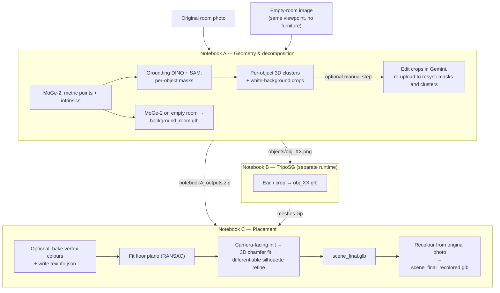

# Single-Image Room → Editable 3D Scene

Turn **one photo of a furnished room** into a **layered 3D scene** (`.glb`): a background room shell plus individual, re-positionable 3D objects (sofa, table, plants, lamp, rug, …) placed at the correct position, scale, and orientation as seen in the photo.

The pipeline is split into three Google Colab notebooks that hand data to each other through a simple folder / zip contract:

| Notebook | Purpose | Key models / libs |
|---|---|---|
| **`A_MoGe___Grounded_SAM___Gemini_Sync.ipynb`** | Scene geometry, object detection & segmentation, per-object 3D clusters, background shell | MoGe-2, Grounding DINO, SAM, Open3D |
| **`B_triposg_objects.ipynb`** | Image → 3D mesh for every extracted object | TripoSG |
| **`C_placement_fixed.ipynb`** | Fit each mesh into the scene (floor plane, scale, yaw), optional colour baking, final scene export | PyTorch3D (differentiable silhouette), Open3D, trimesh |

---

## Table of contents

1. [Pipeline overview](#pipeline-overview)
2. [Requirements](#requirements)
3. [Inputs you need to prepare](#inputs-you-need-to-prepare)
4. [Quick start](#quick-start)
5. [Notebook A – Geometry & decomposition](#notebook-a--geometry--decomposition)
6. [Notebook B – Per-object meshes](#notebook-b--per-object-meshes)
7. [Notebook C – Placement & recolouring](#notebook-c--placement--recolouring)
8. [File and folder reference](#file-and-folder-reference)
9. [Configuration cheat-sheet](#configuration-cheat-sheet)
10. [Troubleshooting](#troubleshooting)
11. [Known limitations](#known-limitations)
12. [Credits](#credits)
13. [License](#license)

---

## Pipeline overview



**In one sentence:** MoGe gives metric 3D for the photo, Grounded-SAM tells us *which pixels (and therefore which 3D points) belong to which object*, TripoSG hallucinates a full 3D mesh for each object from its crop, and PyTorch3D optimisation snaps each mesh onto its 3D point cluster and 2D silhouette while standing it on the floor.

---

## Requirements

- A Google account with **Google Colab** (the notebooks use `google.colab.files` for upload/download and install everything with `pip`).
- A **GPU runtime**. The notebooks were written for a free-tier **T4**. Notebook A prints the detected GPU as its first cell.
- **Three separate runtimes** (recommended, and required for B): A, B and C pin or upgrade conflicting packages (e.g. NumPy 1.24.4 in A vs. latest NumPy in B), so do not run them in the same session.
- Internet access for `pip`, `git clone`, and Hugging Face model downloads.
- Time budget: PyTorch3D is **compiled from source in Notebook C (~10–15 min)**.

Main packages installed by the notebooks:

| Notebook | Packages |
|---|---|
| A | `numpy==1.24.4`, `open3d==0.19.0`, `xatlas==0.0.9`, `trimesh==4.4.9`, `plotly==5.24.1`, `opencv-python-headless==4.10.0.84`, `Pillow==10.4.0`, `scipy==1.13.1`, `transformers>=4.44`, `sentencepiece`, `protobuf`, `accelerate`, `einops`, `kornia`, [`microsoft/MoGe`](https://github.com/microsoft/MoGe) (editable install) |
| B | [`VAST-AI-Research/TripoSG`](https://github.com/VAST-AI-Research/TripoSG) + its `requirements.txt` (installed line by line), `trimesh`, `einops`, `omegaconf`, `huggingface_hub`, `pymeshlab` |
| C | `ninja`, `fvcore`, `iopath`, `open3d==0.19.0`, `trimesh`, `opencv-python-headless`, `pygltflib`, [`facebookresearch/pytorch3d`](https://github.com/facebookresearch/pytorch3d) (`@stable`, built from source) |

---

## Inputs you need to prepare

| # | File | Requirements |
|---|---|---|
| 1 | **Original room photo** | A single photo of the furnished room. It is downscaled so its longest side is ≤ **1024 px**. |
| 2 | **Empty-room image** | The **same room from the exact same viewpoint, with the furniture removed**. Used only to build the background shell. The notebooks do not generate it; create it yourself (for example with an image-editing model such as Gemini, or any image editor). |
| 3 | *(Optional)* **Edited object crops** | Cleaned / completed versions of `objects/obj_XX.png` (see [Gemini sync](#optional-gemini-sync-a7b--a7c)). |

Also edit the **object list** (`CFG["OBJECTS"]`) in Notebook A so it describes *your* room. The default is a living room:

```python
"OBJECTS": [
    "sofa with pillows and blanket",
    "coffee table with books, mug and candle",
    "large potted plant with pot and stand",
    "small potted plant with pot",
    "floor lamp",
    "area rug",
    "basket with magazines",
]
```

---

## Quick start

> Open each notebook in Colab, set **Runtime → Change runtime type → GPU**, and run cells top to bottom unless noted.

### Step 1 — Notebook A (runtime #1)

1. Run **A0–A2** (runtime check, dependency install, config/helpers).
   If `open3d` fails to import after A1, **restart the runtime** and re-run A1 (the cell itself prints this hint).
2. Edit `CFG["OBJECTS"]` in A2 for your scene.
3. Run **A3** and upload the **original photo**, then the **empty-room image**.
4. Run **A4–A7** (MoGe scene geometry → point cloud → Grounded-SAM masks → clusters and crops).
5. *(Optional)* Run **A7b/A7c** for the Gemini edit-and-sync loop.
6. Run **A8** (background shell) and **A9** (zips everything and triggers a download).

You now have **`notebookA_outputs.zip`** (and optionally `object_crops.zip`).

### Step 2 — Notebook B (runtime #2, fresh)

1. In **B0**, upload `notebookA_outputs.zip` and **uncomment the `!unzip …` line** so that `/content/outputs/objects/*.png` exists.
2. Run **B1** (clones and installs TripoSG; watch for `SKIP (failed to build)` lines).
3. Run **B2** to generate one `.glb` per object into `/content/outputs/meshes/`.
4. Run **B3** to sanity-check the meshes and download **`meshes.zip`**.

### Step 3 — Notebook C (runtime #3, fresh)

1. Run **C0** (PyTorch3D build, ~10–15 min). If it fails, C2 automatically falls back to an IoU-based yaw search.
2. Put `notebookA_outputs.zip` and `meshes.zip` into `/content/` and run **C1** (extracts all `*.zip` files in `/content` into `/content/outputs`).
   ⚠️ See the [meshes.zip path gotcha](#meshes-folder-is-empty-after-c1) below: `meshes.zip` has no top-level folder, so its files land in `outputs/` instead of `outputs/meshes/`.
3. *(Optional)* Run the **colour-baking cell** (needs the raw TripoSG meshes in `outputs/meshes_raw/`).
4. *(Optional)* Define `KEEP` / `YAW_OVERRIDE` in a cell **before** C2 (see [Notebook C](#notebook-c--placement--recolouring)).
5. Run **C2** → `scene_final.glb`.
6. Set `PHOTO_PATH` to your original photo and run the **recolour cell** → `scene_final_recolored.glb`.

---

## Notebook A – Geometry & decomposition

**File:** `A_MoGe___Grounded_SAM___Gemini_Sync.ipynb`

### What it does

| Cell | Step |
|---|---|
| A0 | Prints Python version and GPU name via `nvidia-smi`. |
| A1 | Pins NumPy 1.24.4 (needed by Open3D 0.19.0), installs all dependencies, clones and installs MoGe, verifies imports. |
| A2 | Config (`CFG`), output folders, logging, Plotly viewers for point clouds and meshes. |
| A3 | Uploads the original and empty-room images; resizes to max 1024 px. |
| A4 | Loads **MoGe-2** (`Ruicheng/moge-2-vitl-normal`) and infers per-pixel 3D points, valid mask, depth and camera intrinsics for the original photo. |
| A5 | Saves the coloured scene point cloud (`scene_cloud.ply`). |
| A6 | **Grounded-SAM**: Grounding DINO (`IDEA-Research/grounding-dino-tiny`) detects objects from the text prompt, SAM (`facebook/sam-vit-base`) turns each box into a mask. |
| A7 | For each detected object: saves its 3D point cluster, mask and a tight crop on a white background; records metadata; saves `floor.ply` (all valid scene points **not** covered by any object mask). Objects with fewer than 50 valid 3D points are skipped. |
| A7b | Zips the crops (`object_crops.zip`) for external editing. |
| A7c | Uploads edited crops and re-synchronises masks/clusters (see below). |
| A8 | Runs MoGe on the **empty-room** image and triangulates the depth grid into a coloured **background mesh** (`background_room.glb`). Triangles across depth discontinuities are dropped using a relative depth-jump threshold. |
| A9 | Zips `/content/outputs` → `notebookA_outputs.zip` and downloads it. |

### Optional Gemini sync (A7b / A7c)

The raw crops are *partial* (occlusions, shadows). To give TripoSG cleaner inputs you can edit them externally:

1. Download `object_crops.zip` (A7b) and edit each `obj_XX.png` in Gemini (amodal completion, shadow removal, etc.).
2. **Keep the filename** (`obj_XX.png`). The ID is parsed with the regex `obj[_-]?(\d+)`.
3. Export each image **square on a white background** and upload them in A7c.
4. A7c then: overwrites `objects/obj_XX.png` with your edit, thresholds it (grey > 245 = background) into a new foreground mask, rescales that mask (aspect-ratio preserving, centred) into the object's **original bounding box** from `meta.json`, intersects it with MoGe's valid-depth mask, and rewrites `masks/obj_XX.png` and `clusters/obj_XX.ply`.

Net effect: the object image TripoSG sees and the 3D point cluster / mask used for placement stay consistent.

### Key settings (`CFG`)

| Key | Default | Meaning |
|---|---|---|
| `OBJECTS` | living-room list | Text prompts for Grounding DINO (joined with `". "`). |
| `BOX_THR` | `0.30` | Grounding DINO box confidence threshold. |
| `TXT_THR` | `0.25` | Grounding DINO text-match threshold. |
| `MOGE_ID` | `Ruicheng/moge-2-vitl-normal` | MoGe checkpoint. |
| `MAX_DIM` | `1024` | Longest image side after resize. |
| `REL_JUMP` | `0.05` | Max relative depth difference within a quad before it is cut from the background mesh. |
| `VIZ_PTS` | `60000` | Max points shown in Plotly previews. |

### Outputs (`/content/outputs`)

```
outputs/
├── scene_cloud.ply          # coloured point cloud of the original photo
├── floor.ply                # scene points not covered by any object mask (floor/walls/etc.)
├── background_room.glb      # vertex-coloured mesh from the empty-room image
├── meta.json                # image size, intrinsics, per-object metadata
├── masks/obj_XX.png         # binary masks (255 = object)
├── clusters/obj_XX.ply      # per-object 3D points (camera frame, coloured)
├── objects/obj_XX.png       # white-background crops (inputs for Notebook B)
└── meshes/                  # (empty here; filled by Notebook B)
```

`meta.json` schema:

```json
{
  "objects": [
    { "id": "obj_00", "label": "sofa …", "n_points": 12345, "bbox": [x0, y0, x1, y1] }
  ],
  "intrinsics": [[fx, 0, cx], [0, fy, cy], [0, 0, 1]],
  "width": 1024,
  "height": 683
}
```

Intrinsics are **normalised** (as returned by MoGe); Notebook C multiplies by `width` / `height` to get pixels.

---

## Notebook B – Per-object meshes

**File:** `B_triposg_objects.ipynb`

Converts each `objects/obj_XX.png` into a mesh using **TripoSG**. Run it in its **own runtime** so TripoSG's dependencies do not clash with MoGe/SAM.

### What it does

| Cell | Step |
|---|---|
| B0 | Upload `notebookA_outputs.zip` (**uncomment `!unzip …`** to extract it); upgrades NumPy for this runtime. |
| B1 | Clones TripoSG, installs `requirements.txt` one line at a time (skips packages that fail to build and tells you which), installs `pymeshlab`, and prints the inference script's `--help`. |
| B2 | For every `objects/*.png` runs `scripts/inference_triposg.py --image-input <png> --output-path meshes/<name>.glb --faces 30000`. Reports failures per object and continues. |
| B3 | Loads each GLB with `trimesh` to confirm it opens, then zips to `meshes.zip` and downloads it. |

### Notes

- `--faces 30000` is the decimation target; change it for lighter / heavier meshes.
- TripoSG is **geometry-first**: the meshes it produces are not guaranteed to carry colour or texture. Colour is added in Notebook C (see below).
- On a T4, if you hit out-of-memory errors, run objects one at a time and/or reduce resolution/steps as described in the TripoSG README.
- TripoSG's CLI and arguments can change between versions. If `scripts/inference_triposg.py` fails, check the `--help` output printed in B1 and the upstream README. (Commented-out code in B2 shows an alternative `TripoSGPipeline` route.)

### Output

```
meshes/obj_00.glb
meshes/obj_01.glb
...
meshes.zip        # zip of the files above (no top-level folder inside)
```

---

## Notebook C – Placement & recolouring

**File:** `C_placement_fixed.ipynb`

Places every generated mesh into the 3D scene so that it matches the photo, then exports a single GLB.

### Cells

| Cell | Step |
|---|---|
| **C0** | Installs build tools and **PyTorch3D** (compiled from source, ~10–15 min). If unavailable, placement runs in a **fallback mode** (IoU-based yaw search instead of gradient-based refinement). |
| **C1** | Extracts every `*.zip` found in `/content` into `/content/outputs` and prints file counts for `clusters`, `masks`, `objects`, `meshes`, plus whether `meta.json`, `floor.ply`, `background_room.glb` exist. |
| **Colour-baking cell** *(optional)* | For each raw mesh in `outputs/meshes_raw/*.glb`, projects colours from the matching `objects/obj_XX.png` onto vertices (front-facing vertices take photo colours, back-facing blend to the average object colour), boosts saturation, writes the result to `outputs/meshes/`, and records each object's front/up axes in `texinfo.json`. Previews are shown if `PREVIEW=True`. |
| **C2** | The placement itself (below). Writes `scene_final.glb` and `debugfit_obj_XX.png` overlays. |
| **Recolour cell** | Re-colours the placed objects with exact colours from the original photo (below). Writes `scene_final_recolored.glb`. |

### How placement (C2) works

1. **Floor plane.** Runs up to 4 RANSAC plane fits (`distance 0.02`, `3` points, `1000` iterations) on `floor.ply`. The plane (with normal flipped so the objects lie above it) that has the highest fraction of object points above it is taken as the floor. Its normal is the "up" direction.
2. **Camera-facing initialisation.** Each mesh is oriented so that its "front" axis points back toward the camera and its "up" axis aligns with the floor normal. Front/up axes come from `texinfo.json` per object; defaults are **+Z front, +Y up** (TripoSG's convention).
3. **Scale & centre.** Initial scale = diagonal of the object's 3D point-cluster bounding box ÷ diagonal of the mesh bounding box; initial centre = cluster mean.
4. **Phase 1: 3D fit (`N_INIT=150` Adam steps).** Optimises yaw (about floor-up), log-scale and residual translation by minimising the chamfer distance between the object's MoGe point cluster and the mesh vertices, with small regularisers. Yaw is clamped to `±YAW_LIMIT` (60°) around the camera-facing prior.
5. **Phase 2: differentiable silhouette refine (`N_REFINE=120` steps, PyTorch3D).** Renders a soft silhouette (256 px) and minimises `1.0 × (0.75·Dice + 0.25·BCE)` against the SAM mask, plus `0.5 ×` point-to-mesh-face distance to the cluster, plus regularisers. The mesh is re-dropped onto the floor every iteration.
   *Fallback (no PyTorch3D):* tries yaw offsets of −40°, −25°, −12°, 0°, 12°, 25°, 40° and keeps the one with the best silhouette IoU.
6. **Finalise.** Applies the optimised transform plus an optional manual yaw (`YAW_OVERRIDE`), snaps the lowest vertex onto the floor plane, prints IoU / scale / yaw, adds the mesh to the scene, and saves a red/green mask-vs-silhouette overlay (`debugfit_obj_XX.png`).

If a mesh has no real colour or texture, C2 projects colour from the object photo onto its vertices automatically (front-facing vertices keep photo colour, others fade to the median object colour).

### Controlling C2: `KEEP` and `YAW_OVERRIDE`

C2 reads these from the notebook globals if you define them **in a cell before C2**:

```python
import numpy as np

# Only place these objects (empty set = place all)
KEEP = {"obj_00", "obj_02", "obj_04"}

# Extra yaw in radians, added on top of the optimised yaw, about the floor normal
YAW_OVERRIDE = {
    "obj_03": np.pi,        # flip it around
    "obj_05": np.pi / 2,    # quarter turn
}
```

### Recolour cell

Projects every visible vertex of the placed **vertex-coloured** meshes into the original photo and copies the exact pixel colour:

- Visibility = vertex faces the camera (`normal · to_camera > 0.05`) **and** is the front-most surface in a global vertex-level depth buffer (tolerance `TOL = 0.04`).
- Hidden / back-facing vertices keep their existing colour.
- Set `PHOTO_PATH` (default `/content/media_living_room.png`) to **your original photo**, i.e. the same image you gave Notebook A. It is resized to match `meta.json`.
- Meshes with real UV textures are not touched. The cell prints how many meshes it selected. The background shell is also vertex-coloured, so check that count if you want only the furniture recoloured.

### Colour-baking settings

| Variable | Default | Meaning |
|---|---|---|
| `FRONT` | `"+z"` | Mesh axis pointing at the viewer in the object photo. |
| `FLIP_U` | `False` | Mirror projection left↔right. |
| `FLIP_V` | `True` | Flip projection up↔down. |
| `SAT_SAMP` | `1.8` | Saturation boost on projected colours (try `1.0` for pale objects such as a beige sofa). |
| `SAT_FILL` | `1.5` | Saturation boost on the back-fill colour. |
| `OVERRIDE` | `{}` | Per-object `(FRONT, FLIP_U, FLIP_V)` for meshes whose preview looks garbled, e.g. `{"obj_05": ("+x", False, True)}`. |

### Placement settings (C2)

| Variable | Default | Meaning |
|---|---|---|
| `RENDER` | `256` | Longest side of the silhouette render. |
| `W_SIL`, `W_3D`, `REG` | `1.0`, `0.5`, `0.02` | Loss weights (silhouette, point-to-mesh, translation regulariser). |
| `N_INIT` / `N_REFINE` | `150` / `120` | Optimisation steps for phase 1 / phase 2. |
| `YAW_LIMIT` | `60°` | Max yaw deviation from the camera-facing prior. |
| `DROP_TO_FLOOR` | `True` | Snap each object's lowest point onto the floor plane. |

### Outputs

```
outputs/
├── texinfo.json                 # per-object front/up axis (from the colour-baking cell)
├── debugfit_obj_XX.png          # red = SAM mask, green = projected mesh silhouette
├── scene_final.glb              # background + all placed objects
└── scene_final_recolored.glb    # same, with exact original-photo colours on visible vertices
```

> **Coordinate frame.** All geometry lives in MoGe's camera frame (OpenCV convention: +X right, +Y down, +Z forward, camera at the origin). If a glTF viewer shows the scene upside-down, rotate it 180° about X.

---

## File and folder reference

Expected layout in `/content/outputs` when Notebook C runs:

```
outputs/
├── meta.json
├── scene_cloud.ply
├── floor.ply
├── background_room.glb
├── masks/        obj_XX.png
├── clusters/     obj_XX.ply
├── objects/      obj_XX.png
├── meshes_raw/   obj_XX.glb     # optional: raw TripoSG meshes, input to the colour-baking cell
└── meshes/       obj_XX.glb     # meshes used by C2 (TripoSG output or baked meshes)
```

Object IDs (`obj_XX`) come from the **detection index** in Notebook A and must match across `masks/`, `clusters/`, `objects/`, `meshes/` and `meta.json`. Detections with < 50 valid 3D points are skipped, so numbering may have gaps.

---

## Configuration cheat-sheet

| I want to… | Change |
|---|---|
| Detect different objects | `CFG["OBJECTS"]` in A2 |
| Detect more / fewer objects | Lower / raise `BOX_THR` and `TXT_THR` in A2 |
| Lighter or heavier meshes | `--faces` in B2 |
| Place only some objects | `KEEP` before C2 |
| Flip an object that faces the wrong way | `YAW_OVERRIDE = {"obj_XX": np.pi}` before C2 |
| Fix garbled baked colours | `OVERRIDE` / `FLIP_U` / `FLIP_V` / `FRONT` in the colour-baking cell |
| Avoid washed-out or oversaturated colours | `SAT_SAMP`, `SAT_FILL` |
| Tighter / looser silhouette match | `W_SIL`, `N_REFINE`, `RENDER` |

---

## Troubleshooting

**`open3d` import fails in Notebook A.**
Open3D 0.19.0 needs NumPy 1.x. A1 pins `numpy==1.24.4`; if any package changes it, restart the runtime and re-run A1.

**`MoGeModel not found`.**
A4 tries `moge.model.v2`, `moge.model.v1`, then `moge.model`. Make sure `/content/MoGe` exists and is on `sys.path`.

**Grounding DINO detects nothing / wrong things.**
Lower `BOX_THR` / `TXT_THR`, or rewrite the prompts to be shorter and more visual.

**TripoSG script fails or arguments differ.**
Check the `--help` printed in B1 and the TripoSG README; adjust the argument names in B2.

**TripoSG out of memory on T4.**
Process one object at a time, restart the runtime between objects if needed, or reduce resolution/steps.

**PyTorch3D build fails.**
C2 still runs in fallback mode (IoU yaw search, no gradient-based silhouette refinement). Expect looser fits.

<a id="meshes-folder-is-empty-after-c1"></a>
**`meshes: 0 files` after C1.**
`meshes.zip` is created from the *contents* of the meshes folder, so extracting it into `/content/outputs` puts the `.glb` files in `outputs/` rather than `outputs/meshes/`. Fix it by extracting that zip into the right folder:

```python
import zipfile, os
os.makedirs("/content/outputs/meshes", exist_ok=True)
zipfile.ZipFile("/content/meshes.zip").extractall("/content/outputs/meshes")
```

To use the colour-baking cell, extract to `/content/outputs/meshes_raw` instead.

**An object is flipped / facing away.**
Check its `debugfit_obj_XX.png`, then set `YAW_OVERRIDE` (C2) or the per-object `OVERRIDE` (baking cell).

**Objects float or sink.**
Check the printed `floor up = …` normal in C2. A wrong floor plane usually means `floor.ply` is dominated by walls; make sure the photo shows enough floor.

**Colours on the back of objects look flat.**
By design: only camera-visible vertices receive exact photo colours; hidden ones keep their previous colour.

---

## Known limitations

- **Single view:** hidden sides of objects are inferred by TripoSG; the geometry is plausible, not measured.
- **Empty-room image required:** it must match the original viewpoint exactly, otherwise the background shell will not align with the objects.
- **Gemini step is manual:** editing and re-uploading crops is a human-in-the-loop step, not an API call.
- **Floor assumption:** objects are dropped to a single dominant floor plane; wall-mounted or hanging items are not handled specially.
- **Scale/pose are optimised per object independently:** there is no inter-object collision or contact reasoning.
- **Upstream APIs move:** MoGe, TripoSG and PyTorch3D are cloned from their main/stable branches (or pinned loosely), so a future upstream change may require small edits.

---

## Credits

This project builds on:

- [**MoGe / MoGe-2**](https://github.com/microsoft/MoGe), monocular geometry estimation (Microsoft)
- [**Grounding DINO**](https://huggingface.co/IDEA-Research/grounding-dino-tiny), open-set detection (IDEA Research)
- [**Segment Anything (SAM)**](https://huggingface.co/facebook/sam-vit-base), segmentation (Meta AI)
- [**TripoSG**](https://github.com/VAST-AI-Research/TripoSG), image-to-3D mesh generation (VAST-AI-Research)
- [**PyTorch3D**](https://github.com/facebookresearch/pytorch3d), differentiable rendering (Meta AI)
- [**Open3D**](http://www.open3d.org/), [**trimesh**](https://trimsh.org/), [**pygltflib**](https://pypi.org/project/pygltflib/), [**OpenCV**](https://opencv.org/), [**Plotly**](https://plotly.com/python/)
- **Google Gemini**, used manually for empty-room generation and object-crop clean-up

Please check each upstream project's licence and model-weight terms before commercial use.

---

## License

Add your licence here (e.g. MIT) and include a `LICENSE` file in the repo root.
